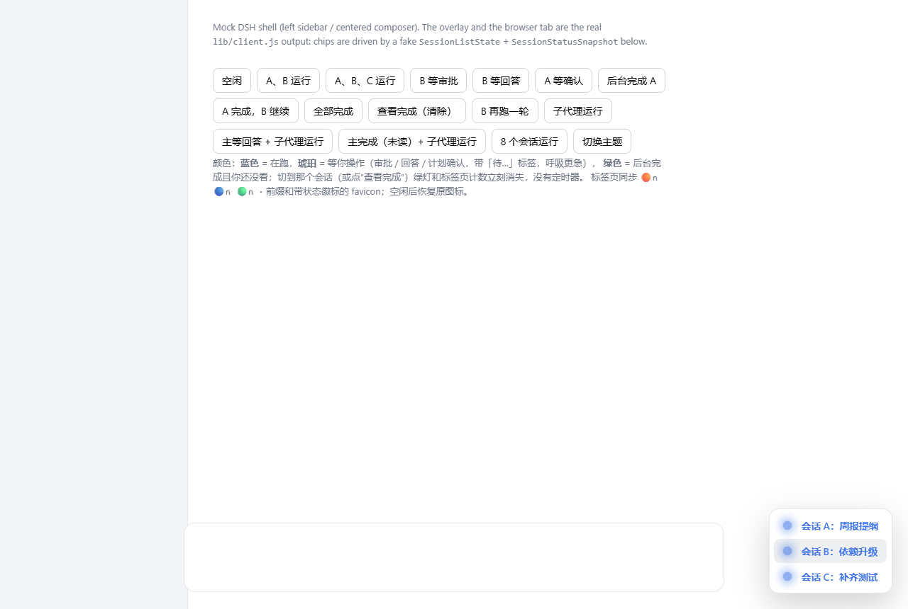

# dsh-busy-light

**简体中文** | [English](./README.en.md)

DSH Web GUI 的会话「呼吸灯」面板：谁在跑、谁在等你、谁刚完成，一眼看完，点一下就能跳过去。



## 它做什么

- **一行一个会话**，按状态给视觉信号：
  - 🔵 **蓝色呼吸** = 运行中
  - 🟠 **琥珀常亮 + 标签** = 正在等你操作（「待审批」/「待回答」/「待确认」），全panel最亮
  - 🟢 **绿色常亮** = 后台完成的未读会话；**点开即清**，不靠定时器
  - ⚪ **灰色静态** = 上下文行（子代理的父行，或「已完成但子代理还在跑」的主行），不算完成、不呼吸、不计数
- **严格树形对齐**：主会话共享一条基线，子代理缩进挂在父会话下面，带树干线，并显示子代理创建时的标签（与侧栏一致）
- **父没结束就不许报完成**：主会话回合结束、但还有子代理在跑时，主行降级为灰色 context 行，而不是绿色
- **折叠**：默认最多 6 行，超出显示「还有 N 个会话 ▾」可展开；展开后可「收起 ▴」
- **拖动**：按住面板任意位置拖动，位置记在 `localStorage`，窗口变化时自动收进视口
- **点击跳转**：任意一行 → 打开对应会话（子代理行打开它的父会话）
- **浏览器标签**：
  - 标题前缀按状态给表情（只统计**主会话**，子代理不计数）
  - favicon 叠加呼吸徽标；被宿主替换/重建时自动重新接管，空闲时精确还原

## 安装

> 需要支持 Web 客户端插件（`package.json` 的 `dsh.client.platform: "web"`）的 DSH 版本。

### 方式 A：从 npm（发布后）

```bash
dsh plugin --profile web add dsh-busy-light
```

### 方式 B：从 git（本仓库）

```bash
dsh plugin --profile web add git+https://github.com/alain-zhu/dsh-busy-light.git
```

### 方式 C：本地目录（开发调试）

```bash
dsh plugin --profile web add link:D:/path/to/dsh-busy-light
```

**装完必须补一行 loader 配置**，编辑 `~/.dsh/profiles/web/cordis.patch.yml`，在顶层数组里加：

```yaml
- insert:
    - id: dsh-busy-light
      name: dsh-busy-light
```

然后重启 `dsh web`，硬刷新页面。验证：面板 hover 末尾应出现 `· v0.8.6`，控制台有 `[dsh-busy-light] v0.8.6`。

安装不需要构建步骤：`lib/` 是提交进仓库的产物，也没有任何运行时依赖。

## 状态是怎么来的

| 行状态 | 判据 | 视觉 |
|---|---|---|
| `running` | 会话 `status.running`（子代理行退化为 `summary.running`） | 蓝色呼吸 |
| `waiting` | `status.pendingInteraction.kind` ∈ `approval` / `question` / `plan-review` | 琥珀 + 标签 + 快速脉冲 |
| `done` | `status.completionUnread`（会话停下时不在主视图，切走或运行即清） | 绿色常亮 |
| `context` | 子代理的父行；或已完成但子树里仍有 `running`/`waiting` 的父行 | 灰色静态 |

树结构优先于状态分组：`waiting` → `running` → `done` → `context` 只决定同级行的次序。

## 依赖的公开能力

- 客户端插件协议：`dsh.client.platform: "web"` + `exports["./client"]`，入口走 `window.__ModuleLoader__.load`
- 槽位：`shell.overlay` 注册面板
- Kit hooks：`useSessions`（会话列表）、`useSessionStatus`（运行/待操作/未读）
- 导航：`ctx.inject(['uiWorkspace'])` 后用 `openSession`

没有 cordis 依赖，也没有 React 依赖（React 由宿主提供），所以 `npm install` 不需要任何参数。

## 开发

```bash
node verify/smoke.mjs      # 纯模型：树构建、降级、折叠、标签前缀
node verify/render.mjs     # jsdom：完整渲染、点击、拖拽、favicon 自愈
node verify/browser.mjs    # 真实 Chromium：截图 + 交互断言（需要 Playwright）
```

`verify/preview.html` 可以直接用浏览器打开，按钮切换各状态，调样式用。
运行时调试可读 `window.__dshBusyLight.model`，里面是当前渲染用的行模型。

## 兼容性

- 依赖的宿主能力（`dsh.client` 声明、`shell.overlay` 槽位、`useSessions`/`useSessionStatus` kit、`uiWorkspace.openSession`）在 2026-10 的快照上验证通过
- 面板只读状态、只写标题/favicon/`localStorage`，不拦截任何会话执行

## License

MIT
